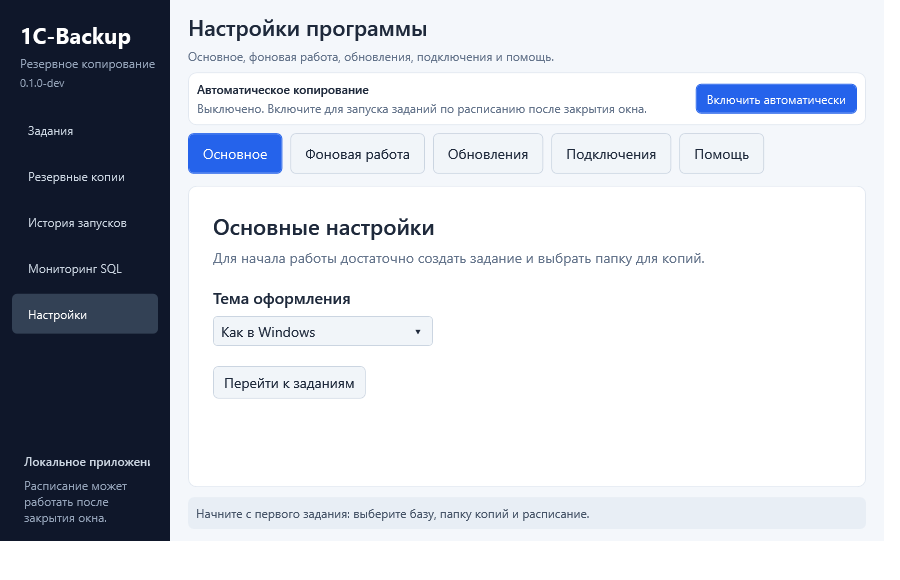

# 1C-Backup: с установки до первой проверенной копии

Начните с разделов 1–4. Для обычной папки не нужны сервер мониторинга, база данных, токены или настройка шлюза. Оставшиеся разделы открывайте по своей задаче.

В руководстве используются новые разделы «Настроек», которые готовятся после alpha.24. В alpha.24 настройки расположены на одной длинной странице: найдите на ней блок с тем же названием. Например, диагностика находится в «О программе» / «Диагностика», а не на отдельной странице «Помощь».

## 1. Скачать и установить программу

1. Откройте [список выпусков 1C-Backup](https://github.com/sanekman/1C-Backup/releases).
2. Найдите выпуск **1C-Backup для Windows x64**. Не выбирайте **Server** или **Storage**: это другие компоненты, для первой копии они не нужны.
3. В списке **Assets** скачайте файл, название которого заканчивается на **windows-x64-setup.exe**. Например: **1C-Backup-0.2.0-alpha.24-windows-x64-setup.exe**. Номер версии может отличаться. Файлы **.sha256** и **Source code** не являются установщиками.
4. Откройте папку «Загрузки» и дважды нажмите скачанный файл. В запросе Windows на установку выберите «Да». Если Windows требует пароль администратора, понадобится пользователь, которому разрешена установка программ на этом компьютере.
5. Пройдите шаги установщика, оставив предложенную папку программы. Отдельно устанавливать .NET не нужно.
6. Откройте меню «Пуск», найдите **1C-Backup** и запустите программу обычным щелчком.

**Проверьте:** слева видны разделы «Задания», «Резервные копии», «История запусков» и «Настройки». Если открылась веб-страница сервера, выбран другой компонент: для этого руководства нужна программа Windows.

Переносной ZIP — дополнительный вариант. Его нужно сначала полностью распаковать и запускать **OneCBackup.Desktop.exe** из распакованной папки. Один EXE без остальных файлов не работает. Для установки службы используйте setup.exe.

## 2. Сделать первую копию на безопасном примере

Сначала потренируйтесь на одной папке с ненужным тестовым файлом. Это позволит проверить работу без риска для рабочей базы.

1. Нажмите правой кнопкой на пустом месте рабочего стола, выберите **Создать → Папку**, назовите её **Тестовые данные** и нажмите Enter. Откройте папку двойным щелчком. На пустом месте выберите **Создать → Текстовый документ**, откройте его, напишите **Проверка копирования**, нажмите **Ctrl + S** и закройте редактор.
2. Рядом на рабочем столе создайте другую папку — **Тестовые копии**. Папка для копий должна находиться **вне** папки с исходными данными.
3. В программе откройте **Задания** и нажмите **+ Новое задание**. При первом запуске можно нажать **Создать первое задание**.
4. В названии укажите **Проверка документов**. В типе источника выберите **Файлы и папки**.
5. Нажмите кнопку выбора папки рядом с источником и выберите созданную папку **Тестовые данные**. Оставьте способ **Полная — все файлы**. Нажмите **Далее**.
6. На шаге хранилища выберите **Локальная папка** / локальный диск и укажите папку **Тестовые копии**. Если такого диска или папки нет в списке, сначала создайте папку в Проводнике. Временную папку пока оставьте пустой: программа использует стандартную.
7. На шаге расписания выберите **Только вручную**. Число сохраняемых копий пока оставьте предложенным. На следующем экране проверьте название, источник и папку копий, затем нажмите **Сохранить задание**.
8. Выберите созданную строку в списке и нажмите **Создать копию**. Дождитесь завершения. Если уже копируется другое задание, новый ручной запуск подождёт в очереди.

**Проверьте:** в «Истории запусков» появился завершённый запуск без ошибки. В «Резервных копиях» есть новый архив, а кнопка «Последняя копия» открывает сведения о нём.

Две папки на рабочем столе подходят для упражнения. Для настоящих данных выберите другой физический диск, внешний накопитель, сетевую папку или настроенное удалённое хранилище: поломка одного диска не должна уничтожить и источник, и все его копии.

## 3. Убедиться, что копия действительно восстанавливается

Наличие ZIP в папке ещё не означает, что вы проверили восстановление.

1. Если включено автоматическое копирование, дождитесь завершения текущей операции и нажмите **Остановить** в верхней панели. Не закрывайте программу.
2. Откройте **Резервные копии**. Если копий много, выберите задание **Проверка документов** в фильтре.
3. Выберите созданную копию. Нажмите **Проверить целостность** и дождитесь результата.
4. Нажмите **Восстановить файлы…**. В Проводнике заранее создайте пустую папку **Проверка восстановления**, затем выберите её в диалоге программы.
5. Программа создаст внутри неё новую папку. Откройте восстановленный текстовый документ: в нём должна быть фраза **Проверка копирования**.

**Проверьте:** восстановленная папка содержит ваш файл с правильным текстом. Исходная папка при этом не изменена. После такой проверки можно создать отдельное задание для настоящих документов.

Для инкрементной копии программа сама проверяет и применяет нужную цепочку. Не удаляйте вручную её полную основу или промежуточные архивы. Если архив зашифрован, потребуется его пароль; обычный Проводник может не поддерживать такой ZIP.

## 4. Настроить ежедневное копирование

1. В «Заданиях» выберите нужное задание и нажмите **Изменить**.
2. Пройдите шаги источника и хранилища, ничего не меняя, до шага расписания.
3. Выберите **Ежедневно**, задайте время, например **21:00**, и включите расписание задания. Время соответствует часам Windows на этом компьютере.
4. Проверьте итог и сохраните задание. Посмотрите указанный следующий запуск: день и час должны соответствовать вашему намерению.
5. В верхней панели нажмите **Включить автоматически**. Дождитесь сообщения, что фоновая работа включена.
6. Теперь окно можно закрыть: агент продолжит работать. Компьютер должен оставаться включённым и не спать; внешний диск или сеть должны быть доступны к назначенному времени.

**Проверьте после выбранного времени:** в «Истории запусков» появился новый результат, а в «Резервных копиях» — новая копия. Если время ещё не наступило, можно отдельно нажать «Создать копию»: ручной запуск остаётся доступен при работающем расписании.

Две разные настройки отвечают за разные вещи: **расписание задания** задаёт время, а **Включить автоматически** запускает исполнителя, который его выполняет. Одного сохранённого времени недостаточно.

## 5. Запускать агент после входа в Windows или без входа

**Если вы обычно входите в Windows перед работой:**

1. Откройте **Настройки → Фоновая работа**.
2. Включите **Запускать агент при входе в Windows**.
3. Нажмите **Сохранить автозапуск**. Эта настройка действует при следующем входе. Для работы прямо сейчас также включите автоматическое копирование в верхней панели.
4. После следующего входа откройте программу и убедитесь, что фоновая работа включена. Не выбирайте «Выйти полностью», если хотите оставить агент работающим.

**Если копии должны делаться после перезагрузки, пока никто не вошёл в Windows:**

1. Установите программу через setup.exe: переносной ZIP не регистрирует службу.
2. В верхней панели остановите работающий агент и дождитесь завершения операций.
3. Откройте **Настройки → Фоновая работа → Установить или настроить службу**.
4. Выберите пользователя Windows, которому доступны ваши файлы и папка копий. Для первого локального задания обычно удобен пользователь, под которым вы уже проверили ручную копию.
5. Введите **пароль Windows**, а не PIN-код входа. Пользователя без нужного пароля или без прав на данные недостаточно выбрать из списка.
6. Нажмите **Установить службу…** и подтвердите запрос администратора. Дождитесь результата; если служба установлена, но остановлена, нажмите **Запустить**.
7. Проверьте статус службы, включённое расписание заданий и следующий запуск. После выполнения проверьте историю.

Для сетевых папок службе нужен путь вида **\\SERVER\Backups**, а не подключённая буква **Z:**. Учётная запись службы должна иметь доступ к этой папке. Подробнее о подготовке доступа и смене пользователя: [служба Windows](https://github.com/sanekman/1C-Backup/blob/feature/local-backup-agent/docs/windows-service.md).

## 6. Делать полную копию раз в неделю, а между ними — только изменения

Это подходит для **Файлов и папок** и **WebDAV**. Восстановление изменений требует полную основу и последующие архивы.

1. Откройте задание через **Изменить**.
2. На шаге источника выберите **Инкрементная — только изменения**.
3. В **Когда делать полную копию** выберите день, например **Воскресенье**.
4. В расписании оставьте ежедневный запуск, например в **21:00**, и сохраните задание.

**Пример:** первый запуск во вторник создаст полную копию сразу. Затем каждый день сохраняются изменения. В воскресенье при первом запуске будет новая полная. Если в воскресенье компьютер был выключен, при ближайшем запуске, например в понедельник, создастся полная; затем снова идут изменения. Повторные запуски в тот же день не создают ещё одну полную.

Выбор дня определяет **тип** копии при запуске, но сам не добавляет время в расписание. Чтобы копирование происходило каждый день, нужно ежедневное расписание и работающий агент.

Для старого режима выберите **По числу архивов**. Например, 7 — полная основа и до 6 инкрементных архивов, затем новая полная. В календарном режиме это число не задаёт период; остаётся защитный предел цепочки в 365 архивов.

## 7. Создать задание для файловой базы 1С

Файловая база обычно находится в папке с файлом **1Cv8.1CD**. Если вы подключаетесь к базе на сервере 1С и такой папки нет, не выбирайте папку программы 1С: сначала нужно узнать, используется MS SQL или PostgreSQL.

1. Создайте новое задание и выберите **Файловая 1С**.
2. Выберите базу из списка или укажите её папку вручную. Пример папки: **D:\Базы\Бухгалтерия**. Это папка данных, не папка установки платформы 1С.
3. Для первого понятного сценария выберите способ **Архив файла 1Cv8.1CD**. Перед запуском все пользователи должны закрыть эту базу. Программа проверит возможность эксклюзивного доступа.
4. Выберите отдельную папку для копий, задайте расписание или «Только вручную», проверьте итог и сохраните.
5. Закрыв базу у всех пользователей, выполните первую ручную копию и проверьте результат.
6. В «Резервных копиях» выберите архив и используйте действие извлечения **1Cv8.1CD** в новую папку. Исходная рабочая база не заменяется. Добавьте восстановленную папку в список баз 1С и отдельно проверьте вход и нужные документы.

Второй способ — выгрузка **.dt** через установленную платформу 1С. Для неё нужны платформа, доступ к базе и возможность входа в Конфигуратор; одного пути к папке недостаточно. Если требуются учётные данные 1С, укажите их в настройках задания. Проверку восстановления .dt выполняют средствами 1С в отдельную тестовую базу.

Если копия не начинается из-за занятой базы, сначала закройте пользовательские сеансы. Разрешение копировать открытую базу не делает её согласованным снимком.

## 8. Использовать внешний диск или сетевую папку

**Внешний диск:** подключите его, откройте в Проводнике и создайте папку для копий. Выберите её в задании. Проверьте, что диск подключён и его буква не изменилась перед следующим запуском.

**Сетевая папка:**

1. Узнайте имя компьютера/сервера и имя общей папки. Пример полного пути: **\\SERVER\Backups\Бухгалтерия**. Замените SERVER и Backups на свои значения, а не копируйте пример буквально.
2. Нажмите **Win + R**, вставьте путь и нажмите Enter. Должна открыться папка. Если Windows спрашивает пароль, используйте предоставленные вам сетевые учётные данные.
3. Создайте в этой папке тестовый текстовый файл, откройте и удалите его. Если это не удаётся, сначала нужно исправить сетевой доступ; настройка копирования сама не выдаёт права на папку.
4. В задании выберите **Сетевой диск / UNC** и укажите этот путь.
5. Сохраните, выберите задание и нажмите **Проверить хранилища**, затем создайте ручную копию.
6. Если работает служба, доступ нужно проверить для **пользователя службы**, а не только для вошедшего пользователя Windows.

На время недоступности сети копия может завершиться ошибкой доставки. Смотрите результат каждого хранилища, а не только наличие временного файла на компьютере.

## 9. Подключить MS SQL или PostgreSQL

Эти задания копируют базу штатными средствами СУБД. Для первой настройки потребуются данные от человека, который обслуживает базу. Не нужно угадывать адрес, имя базы или путь на сервере.

**Для MS SQL подготовьте:**

- имя экземпляра, например **SERVER\INSTANCE**, и точное имя базы;
- папку для .bak **на SQL-сервере**, куда служба MS SQL может записать файл;
- путь, по которому компьютер с 1C-Backup читает эту же папку, например **\\SERVER\SqlBackups**;
- пользователя Windows с правом резервного копирования базы и чтения готового файла. Сейчас используется Windows-аутентификация: отдельный SQL-логин в задании не вводится.

В новом задании выберите **MS SQL**, заполните источник (имя базы) и подготовленные поля подключения. Папка .bak на сервере и конечное хранилище 1C-Backup — разные места: сначала сервер создаёт .bak, затем агент читает его и доставляет копию в выбранное хранилище.

**Для PostgreSQL подготовьте:** адрес сервера, порт, имя базы, пользователя, совместимые **pg_dump** и **pg_restore**, а для проверки подключения — **psql**. Пароль задаётся стандартным файлом паролей PostgreSQL; в аргументы команды его вставлять не нужно.

После сохранения нажмите **Проверить источник**, затем **Проверить хранилища**, затем создайте первую ручную копию. Успешная проверка подключения не заменяет пробное восстановление. Автоматического восстановления рабочей SQL-базы через интерфейс пока нет: проверку восстановления проводят в отдельной тестовой базе средствами соответствующей СУБД.

Точные примеры полей, парольного файла и ограничений: [настройка SQL-копий](https://github.com/sanekman/1C-Backup/blob/feature/local-backup-agent/docs/sql-backups.md).

## 10. Узнать результат и разобраться с ошибкой

Откройте **История запусков**, выберите нужный запуск или используйте кнопку **Результат** у задания. Сверьте время, результат и каждое хранилище.

- **Успешно без предупреждений:** копия создана и проверена выбранным методом. Для уверенности всё равно периодически проверяйте восстановление.
- **Есть предупреждения / неполная копия:** архив может быть пригоден для восстановления доступных данных, но часть свежих файлов не попала в него. В результате перечислены пропуски. Найдите недоступные файлы и устраните причину; не удаляйте прежнюю цепочку.
- **Частичная доставка:** одна и та же копия могла попасть в одно хранилище и не попасть в другое. Откройте результаты назначений и проверьте каждое отдельно.
- **Ошибка / отменено / прервано:** не считайте запуск готовой копией. Откройте причину и проверьте, есть ли последняя подтверждённая копия.

Частые ситуации:

- **Не запустилось по времени.** Проверьте дату и часы Windows, включённое расписание задания, показанный следующий запуск и состояние автоматического копирования. Компьютер не должен спать. Для работы до входа пользователя нужна служба, а не только автозапуск при входе.
- **Доступ запрещён.** Откройте источник и папку копий в Проводнике и проверьте чтение/запись. При службе уточните её пользователя. Права вашей интерактивной учётной записи и пользователя службы могут отличаться.
- **База 1С занята.** Закройте базу у всех пользователей и повторите копирование. Не включайте разрешение открытой базы просто для устранения сообщения.
- **Нет места.** Проверьте и диск назначения, и временную папку. Оставьте место для новой копии; программа не удаляет прежние копии заранее ради неудачного нового запуска. Старые зависимые архивы не удаляйте вручную.
- **Не виден внешний диск / сетевая папка.** Сверьте букву диска, сетевое соединение и путь. Для службы используйте UNC вместо буквы подключённого сетевого диска.
- **Создать копию временно недоступно.** Дождитесь запуска агента или восстановления его очереди. Если команда уже принята, проверьте историю вместо повторного щелчка. Другое задание можно поставить в очередь, когда агент готов.
- **Не получается восстановить файлы.** Остановите агент, выберите нужную копию и проверьте наличие полной цепочки и пароля. Восстанавливайте в новую папку.

## 11. Передать понятную диагностику

1. Запишите, что вы делали, какое задание выбрали и примерно во сколько возникла проблема. Укажите, работало ли окно, фоновый агент или служба.
2. Откройте **Настройки → Помощь** и нажмите **Сохранить диагностику…**. В alpha.24 найдите эту кнопку на общей странице «Настройки».
3. Выберите удобную папку, например рабочий стол, и сохраните ZIP. Если такой файл уже есть, выберите другое имя: он не перезаписывается.
4. Передайте ZIP и описание проблемы тому, кто помогает с программой. Отправка выполняется вами вручную.

Архив содержит версию, сведения о системе, логи и сокращённые результаты. Пароли, исходные данные и сами копии в него не включаются. Кнопка **Скопировать версию для поддержки** помогает передать номер версии и коммит без перепечатывания.

## 12. Подключить общий мониторинг, если он действительно нужен

Для одной автономной программы этот шаг можно пропустить. Мониторинг нужен, чтобы видеть несколько компьютеров в общей веб-панели; файлы копий продолжают храниться в выбранных вами хранилищах.

1. На отдельном компьютере установите **1C-Backup Server**, а не ещё один агент. При установке имя — понятная подпись панели, например **Бухгалтерия**, а адрес — полный **HTTPS-адрес подключения**. Это разные поля.
2. Откройте панель сервера и создайте приглашение на подключение компьютера.
3. На компьютере с агентом откройте **Настройки → Подключения → Подключить по приглашению…**.
4. Перенесите из приглашения адрес сервера, одноразовый код и SHA-256 сертификата, затем подтвердите подключение.
5. Создайте тестовую копию и проверьте, что компьютер и его результат появились в панели. Для отправки при закрытом окне оставьте работающим агент или службу.

Режим «Управление через сервер — в разработке» для мониторинга включать не нужно. Пошаговая установка с подготовкой адреса, входом и приглашениями: [первый запуск сервера Windows](https://github.com/sanekman/1C-Backup/blob/feature/local-backup-agent/docs/server-first-start.md). Технические параметры: [руководство сервера](https://github.com/sanekman/1C-Backup/blob/feature/local-backup-agent/docs/server-start.md).

## 13. Обновить программу и сохранить настройки

1. Закончите текущую копию. Если обновляетесь скачанным установщиком вручную, выберите **Выйти полностью** в меню значка возле часов и дождитесь остановки агента.
2. Запустите новый setup.exe в ту же папку программы. Не удаляйте профиль, историю или папку с копиями.
3. Откройте программу под тем же пользователем Windows, проверьте список заданий и состояние агента/службы.
4. Для встроенного обновления откройте **Настройки → Обновления → Проверить обновления** и следуйте показанному действию. Встроенное обновление само выполняет остановку перед установкой; Windows запросит права администратора.
5. После обновления проверьте следующий запуск и сделайте тестовую ручную копию. При переносном ZIP заменяется весь комплект файлов, а не один EXE.

## 14. Как найти нужную настройку

Пример нового экрана настроек. Номер сборки в вашем окне может отличаться.

- **Основное:** тема программы и переход к заданиям.
- **Фоновая работа:** запуск после входа, служба без входа и отдельный режим работы только при открытом окне.
- **Обновления:** поиск и установка новой версии; специальные параметры скрыты в дополнительном блоке.
- **Подключения:** общий мониторинг и переход к настройке оповещений. Публичные шлюзы и Managed предназначены для отдельной технической настройки.
- **Помощь:** это руководство, диагностика, логи и версия программы.

Руководство установлено вместе с программой в **Help/user-guide.html** и открывается без интернета. Ссылки на загрузку и дополнительные документы требуют подключения к интернету.
